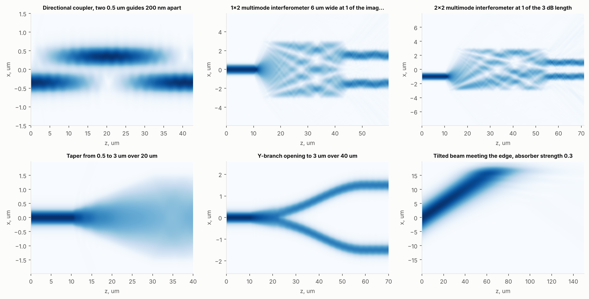

# BeamProp

A finite-difference beam propagation solver for planar photonic circuits in C++17, with no dependencies: paraxial Crank-Nicolson stepping, absorbing edges, straight guides, tapers, S-bends and tilted guides, slab-mode and Gaussian launches, mode-overlap monitors.

The repository is also a library of 81 circuit layouts: couplers, multimode interferometers, tapers, bends, splitters and free beams. Each file states in its first lines what it shows and what it is checked against, and carries the result as machine-checked expectations. Every layout is propagated a second time by an independent NumPy implementation.

## What is inside

| Part | Where | Content |
|---|---|---|
| Stepping | `cpp/src/stepper.cpp`, `tridiagonal.cpp` | one Crank-Nicolson step as a complex tridiagonal solve |
| Layout | `layout.cpp` | guide segments, permittivity profile with cut cells, absorbing layer |
| Modes | `slab.cpp` | TE modes of a symmetric slab, any guided order |
| Simulation | `simulate.cpp` | launch, monitors, planes, power traces, index from the phase, intensity map |
| Files | `parser.cpp`, `expect.cpp` | text format, eleven kinds of expectation |
| Library | `cases/*.bpm` | 81 layouts in ten families |
| Reference | `src/beamprop/reference.py` | independent propagation; a modal solution with no stepping; closed forms |
| Results | `reports/cases/*.json`, `reports/figures/cases/*.png` | monitors, checks, field map and power trace of every layout |

180 C++ checks; pytest runs every layout of the library as its own test.

## Results

81 layouts, 46 million cell-steps, 586 checks, all passing. Full tables in `reports/report.md`.

| Family | Layouts | What is verified |
|---|---|---|
| Free propagation | 8 | Gaussian beam radius against the closed form within 0.1%; tilted beams at z sin(angle) |
| Straight guides | 10 | modes of order 0 to 2 keep 99.95% in their mode; index from the phase against the mode of the grid to 2e-6, for good and poor reference indices |
| Launch conditions | 7 | guided power of mismatched and offset launches against analytic overlap integrals within 3e-4 |
| Directional couplers | 9 | full transfer at the coupling length predicted from the supermodes, sin^2 law at other lengths |
| Multimode interferometers | 14 | 1x2 and 2x2 splitting at the imaging lengths, and its collapse 10 and 20% away from them |
| Tapers | 8 | transmission from 93.1% over 5 um to 99.95% over 80 um; reciprocity |
| S-bends | 7 | offsets of 1 to 4 um |
| Y-branches | 4 | equal arms by symmetry |
| Absorbing edges | 6 | what is left of a beam that should have gone |
| Step and grid | 8 | second-order convergence in the step; sensitivity to the transverse grid |

Agreement between the C++ solver and the NumPy reference over the whole library: monitor powers to 5e-11, the whole output field to 4e-11 of its peak.



## Four things the solver makes visible

1. **Coupling length is a property of two supermodes.** A dense eigen-solve of the transverse grid predicts 8.4, 13.1, 20.4, 31.7 and 49.5 um for gaps of 100 to 300 nm; the launch guide empties within one or two steps of each.
2. **Multimode interferometers are unforgiving in length.** A 6 um wide 1x2 splitter gives 49.2% per output at its imaging length (34.75 um here), 30% at 10% off and 18% at 20% off. The 4 um device, less than half as long, still gives 42 to 44% at 10% off: a length error of 1.6 um there against 3.5 um for the wider one.
3. **Tapers reward length slowly.** From 0.5 to 3 um: 93.1% over 5 um, 97.6% over 10, 99.1% over 20, 99.8% over 40. The mirror-image taper gives the same numbers to all ten printed digits.
4. **An absorber can be too strong.** A beam at 15 degrees leaves 34% behind with a weak layer, 0.05% with a moderate one and 3% with one ten times stronger, which reflects at its own front.

## Reading the numbers

- Two dimensions. The vertical direction is replaced by slab effective indices (2.848 and 1.444 by default, a 220 nm silicon film in oxide). Real strip waveguides are less confined laterally than this model suggests: coupling lengths, bend losses and imaging lengths from a real device or a three-dimensional solver will differ, sometimes by tens of percent. The model is right about trends and mechanisms.
- Scalar and TE-like. No polarisation, no field discontinuity at the side walls.
- Paraxial. Accurate for light within a few degrees of the axis and near the reference index. Tilted beams advance by z sin(angle) instead of z tan(angle) (1.5% at 10 degrees), and modes far from the reference index show a shifted index. Multimode interferometers excite modes over a wide index range, so their imaging lengths here are those of the paraxial model, computed consistently, not those of the Helmholtz equation.
- One-way. Reflections are not modelled; abrupt junctions (the ends of a multimode section) lose light to radiation only.
- Radiated light is not accurate. With quarter-micrometre steps, light radiated at large angles gets the wrong phase (the step saturates); it is absorbed at the edges as intended, but its pattern in the cladding is not to be trusted. Guided powers are unaffected: mismatched launches agree with analytic overlaps within 3e-4.
- S-bend losses are tiny here (0.2% for a 1 um offset over 10 um) because the lateral index contrast of the two-dimensional model is very high. Do not read them as bend losses of real strip waveguides.
- Monitors use analytic modes of isolated guides. For guides closer than about 200 nm these overlap, and two monitors can add up to slightly more or less than the total (0.5% at 100 nm).
- The absorbing layer is a simple lossy region, not a perfectly matched layer; the default (2 um, strength 0.3) suits guided-wave layouts and is too thin for beams at grazing angles.
- The expectations in the layout files and the recomputation in the report come from the same independent implementation of the same scheme, plus closed forms. They verify the solver, not the approximations listed above. There is no comparison with measurements or with a full-wave solver in this repository.
- The per-layout result files and figures are generated by `make run`; they are stored so that the library can be browsed without building anything.

## Run it

```
pip install -e ".[dev]"
make build      # g++ -O2 -std=c++17, solver and its tests
make test       # C++ checks, then pytest (every layout is a test)
make run        # simulates the library, writes reports/ (under a minute)
```

One layout:

```
cpp/build/beamprop check cases/mmi_1x2_w6_l100.bpm
python scripts/simulate.py cases/coupler_gap200.bpm
python scripts/plot_layout.py cases/ybranch_l40.bpm field.png
python scripts/compare_reference.py cases/taper_up_l20.bpm
python scripts/coupling_length.py 0.5 0.2
```

A layout file:

```
# Power moves to the other guide in lambda / (2 (n_even - n_odd)).
title Directional coupler, two 0.5 um guides 200 nm apart
window width=14 length=42.75
guide straight x=-0.35 width=0.5 from=0 to=42.75
guide straight x=0.35 width=0.5 from=0 to=42.75
launch mode x=-0.35 width=0.5
monitor cross_full z=20.25 x=0.35 width=0.5
monitor bar_full z=20.25 x=-0.35 width=0.5

expect power_above cross_full 0.995
expect power_below bar_full 0.005
```

From C++:

```cpp
#include "beamprop/parser.hpp"
#include "beamprop/simulate.hpp"

const bp::Layout l = bp::parse_layout_text(
    "window width=20 length=60\nguide taper x=0 w0=0.5 w1=3 from=0 to=60\n"
    "launch mode x=0 width=0.5\nmonitor out z=60 x=0 width=3\n");
const bp::Result r = bp::simulate(l, false);
std::printf("transmission %.4f\n", r.monitors[0].power);
```

## Layout

```
cpp/include/beamprop/   headers: types, tridiagonal, slab, layout, stepper, simulate, parser, expect
cpp/src/                implementation and the command line program
cpp/tests/              one test file per module, a small check harness
cases/                  81 layouts, each with its description and expectations
src/beamprop/           Python driver, independent reference, comparison, studies, report and figures
docs/                   layout file reference, method and limits
reports/                report, validation table, per-layout results and field maps
```

## Author

Amir Masominia. PhD in physics (Université Paris-Saclay); postdoctoral researcher working on machine-learning surrogate models, numerical simulation and automated measurement pipelines.

MIT licence.
